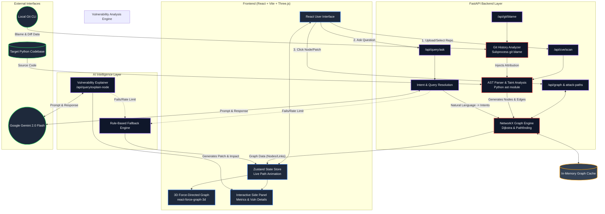

# VulnGraph Architecture

VulnGraph's architecture is designed around a clear pipeline: **Extract → Analyze → Enrich → Visualize & Query**. 

Below is the detailed architectural diagram illustrating the components and data flow, followed by an explanation of the core elements.

## System Architecture Diagram

---

## Core Elements Explained

### 1. The Target Codebase (Input)
VulnGraph acts directly on Python source code (either via a local folder path or uploaded `.zip`). It does **not** execute the code (SAST approach), ensuring complete safety when analyzing malicious or highly vulnerable applications.

### 2. AST Parser & Taint Analysis (`backend/services/code_security_graph.py`)
This is the workhorse of the application. 
- It uses Python's native `ast` module to build an Abstract Syntax Tree of the entire project.
- It employs a **Visitor Pattern** (`_TaintVisitor`) to walk the tree, hunting for:
  - **Sources**: Untrusted inputs (e.g., `request.args`, `flask.request.form`).
  - **Sinks**: Dangerous execution points (e.g., `cursor.execute()`, `subprocess.run()`, `eval()`).
  - **Sanitizers**: Defensive functions (e.g., `escape()`, `validate()`).
- It maps the flow of variables from sources to sinks to generate data-flow edges.

### 3. Graph Engine (`backend/services/graph_engine.py`)
- Powered by **NetworkX**, this engine takes the nodes and edges from the AST parser and builds a Directed Graph (`DiGraph`).
- It executes pathfinding algorithms (like Dijkstra's) to find the shortest, most dangerous routes from a source to a sink.
- It calculates dynamic risk scores based on path length and the presence of sanitizers.
- **The "Patch" Mechanism:** When a user clicks "Mark as Patched", the engine removes the node/edges from the NetworkX graph and recalculates the attack surface instantly.

### 4. Git History Analyzer (`backend/services/git_history.py`)
- Maps the vulnerability back to the human who introduced it.
- Uses `subprocess` to execute `git blame --porcelain` on the exact file and line number of a detected source or sink.
- Calculates the **Blast Radius** by running `git show --stat` to see how many other files were modified in that exact same commit.

### 5. AI Intelligence Layer (`backend/routers/query.py`)
- Integrated with **Google Gemini 2.0 Flash**.
- **Intent Resolution (`/ask`)**: Translates plain English queries ("show me SQL injection paths") into actionable graph traversal commands (e.g., `{"intent": "show_attack_paths", "risk_filter": "HIGH"}`).
- **Vulnerability Explanation (`/explain-node`)**: Analyzes specific sink nodes to generate structured security reports: Impact, Root Cause, Fix, and CWE mappings.
- **Resiliency**: If the Gemini API hits a rate limit or lacks a key, a robust **Rule-Based Fallback Engine** seamlessly takes over using regex and keyword mapping so the demo never breaks.

### 6. Frontend Presentation Layer (`src/components/`)
- Built on **React** and **Vite**.
- **`GraphCanvas.jsx`**: Uses `react-force-graph-3d` and `Three.js` to render the NetworkX graph in a 3D space. Nodes are color-coded (Red = Sink, Green = Source), and active attack paths emit glowing, directional particles.
- **`QueryBar.jsx`**: The command center. It dispatches AI queries, triggers full-project scans, and manages the multi-path `setInterval` animation cycle.
- **`SidePanel.jsx`**: The "War Room". It displays the exact file/line, the Gemini AI vulnerability analysis, the Git Time-Travel attribution, and the real-time "Patch" controls. 
- **`MetricsBar.jsx`**: Uses `zustand` to monitor the live state of the graph, showing the total attack surface and shifting risk posture as nodes are dynamically patched.
